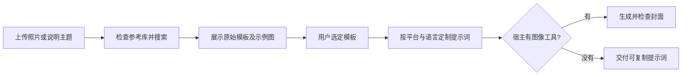

# AI Image Prompts Skill · 图像提示词与封面创作

**中文** | [English](README.en.md) · **发布版 v1.1.0** · 上游 **v1.0.4** · MIT

从社区提示词库中查找风格，查看示例，再将模板定制为自己的图像提示词。适用于照片封面、电商、穿搭、旅行日记、海报与内容配图。本仓库在 YouMind 原版基础上补齐安装器、中英教程、真实图文案例与可复制模板。

> 技能负责“查找与定制提示词”；生成图片需要宿主提供图像工具。安装本仓库不会自动获得图片模型或 API 配额。

<a href="examples/taman-kemesraan/lemon8-ms.png"></a>
<a href="examples/taman-kemesraan/lemon8-zh.png"></a>
<a href="examples/beach/xiaohongshu-zh.png"></a>

*真实制作案例：马来文 Lemon8、中文 Lemon8、日系杂志风小红书封面。图片已随仓库保存，点击查看原图。*

## 三分钟开始

1. [下载 v1.1.0](https://github.com/pusatpakaiankime-bit/ai-image-prompts-skill/releases/tag/v1.1.0)，解压完整 ZIP。
2. 在包含 `SKILL.md` 的目录打开终端，运行以下命令（需要 Node.js 20+；推荐 22 LTS）。

```sh
node scripts/install.js --dry-run
node scripts/install.js
```

默认安装到 `~/.agents/skills/ai-image-prompts-skill`。安装器离线运行，不覆盖已有目录；项目级安装、自定义路径及旧版 `.codex/skills` 路径见[安装教程](docs/installation.md)。下一轮对话使用技能，未发现时重新打开宿主。

3. 上传照片，并复制以下请求：

```text
使用 $ai-image-prompts-skill，根据这张照片帮我查找适合 Lemon8 的封面模板。
先展示最多 3 个模板及示例图，让我选择。
平台：Lemon8；比例：3:4；文字语言：Bahasa Melayu。
主题：自然风景与周末旅行。保留人物脸部、头巾、服装与动作。
```

4. 看完示例，回复选择，再要求定制或生成：

```text
选择第 1 个。请改成适合我照片的封面提示词。
主标题：HUJUNG MINGGU DEKAT DENGAN ALAM
地点：Taman Kemesraan
如果当前宿主支持图像编辑，请直接出图；否则给我完整可复制的提示词。
```

## 完整文档

所有下列教程均为中英双语；封面案例另外包含马来文。

| 文档 | 内容 |
| --- | --- |
| [安装与升级](docs/installation.md) | Git、ZIP、离线安装、自定义目录、升级与卸载 |
| [完整使用教程](docs/usage.md) | 从上传资料、选模板到出图、局部修改、翻译 |
| [图文案例](docs/examples.md) | 原图 → 中文封面 → 马来文封面；实际提示词 |
| [模板目录](docs/templates.md) | 请求表、Lemon8、小红书、语言替换、推荐结果格式 |
| [故障排查](docs/troubleshooting.md) | 图片不显示、技能未发现、更新失败、文字错误 |
| [结构与维护](docs/architecture.md) | 数据字段、参考库更新、运行脚本与维护脚本的区别 |
| [版本发布流程](docs/releasing.md) | 校验、打包、校验和、GitHub Release |
| [来源与变更](docs/upstream.md) | 原作者、上游版本、发布版修改范围 |
| [版本记录](CHANGELOG.md) | v1.1.0 与上游 v1.0.4 |

## 参考库快照

- 11 个用途分类，来自仓库内 `references/manifest.json`。
- 本快照含 **15,260 个不同 ID 的提示词**，合计 **22,985 个分类条目**；同一提示词可能属于多个分类。
- 快照时间：2026-10-23；运行 `node scripts/validate.js` 核对实际文件。
- 类别是动态的；搜索前读取 manifest，不把本页数字当成永久常量。

## 工作流程



## 安装到其他助手

也可使用第三方 [Skills CLI](https://github.com/vercel-labs/skills/blob/main/docs/commands.md)，按提示选择宿主：

```sh
npx skills add pusatpakaiankime-bit/ai-image-prompts-skill
```

该命令需要联网并执行第三方安装器；不等同于本仓库的离线安装器。其他宿主的目录由对应宿主管理。

## 来源与许可

原始技能和提示词库由 [YouMind-OpenLab](https://github.com/YouMind-OpenLab/ai-image-prompts-skill) 提供，本仓库是独立维护的衍生发布版，不是官方上游仓库。保留原始 [MIT LICENSE](LICENSE)；图片与提示词来源说明见 [NOTICE](NOTICE.md)。本地案例为用户提供照片与本次图像编辑结果，具体生成结果可能不同。

提示词由 [YouMind.com](https://youmind.com) 通过公开社区搜集 ❤️
