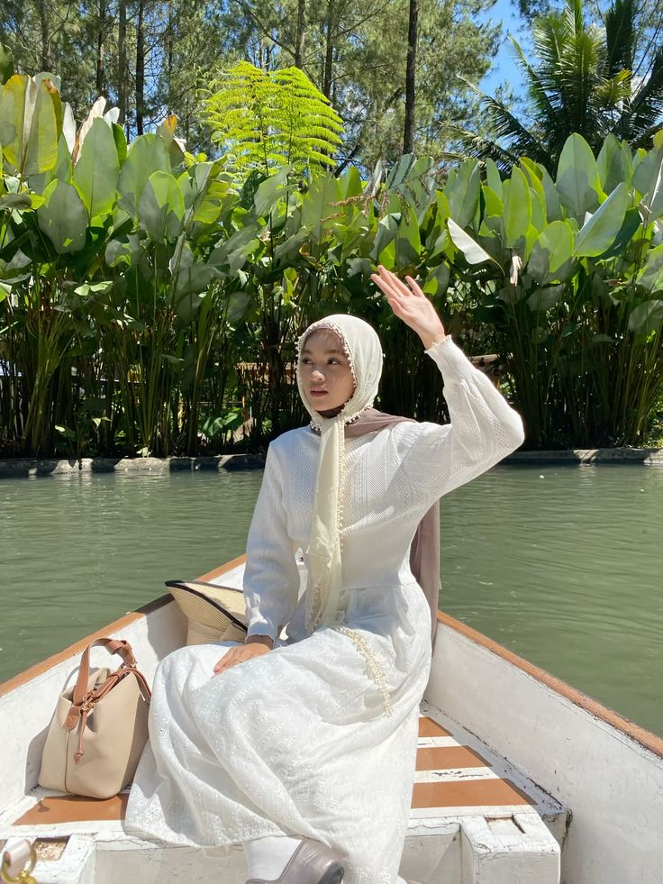
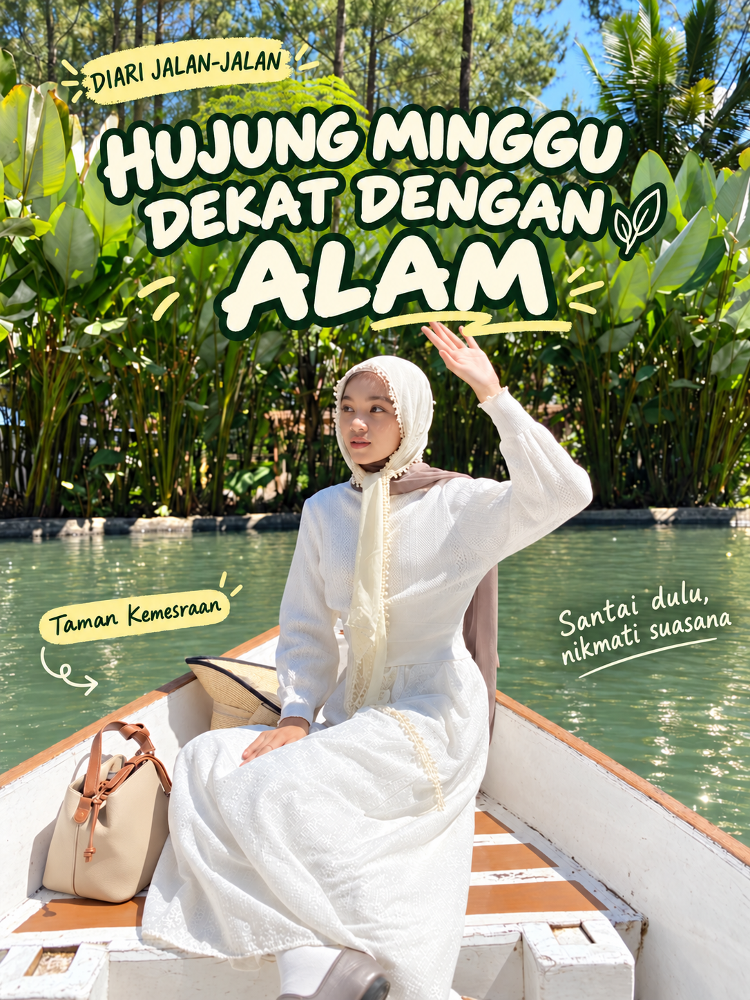
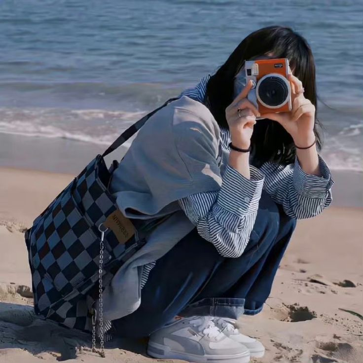
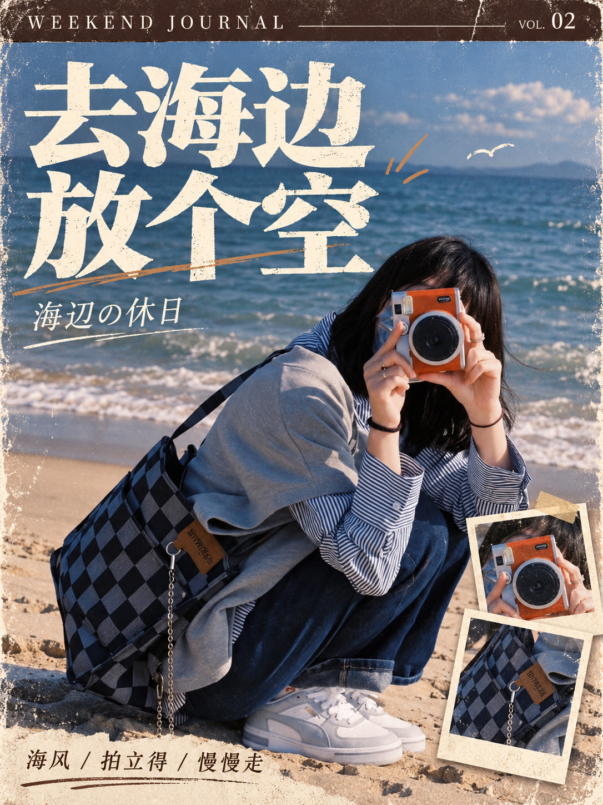

# 图文案例 / Illustrated walkthroughs

[首页 / Home](../README.md) · [使用教程 / Usage](usage.md)

中文：以下为本次实际制作的素材与结果，不是模板库的原始示例图，也不是所有模型都能精确复现的保证。所有展示文件已保存在仓库中，不依赖外部图床。执行提示词以英文编写，封面文案使用指定语言。

English: These are actual source images and generated results from this session, not the library's original sample images or a promise of identical model output. All displayed files are bundled locally. Execution prompts are in English; visible copy follows the requested cover language.

## A. Lemon8 自然旅行封面 / Nature travel cover

### 第一步：上传原图 / Step 1: upload the original

中文：确定可见元素：乘船人物、奶油色头巾、白色长袖裙、米色手提包、绿水与植物。文件名提供了地点标签 Taman Kemesraan；没有从照片推断价格、路线或旅行时长。

English: Visible elements include a seated traveler, cream hijab, white long-sleeved dress, beige handbag, boat, green water, and plants. The supplied filename provides the Taman Kemesraan location label. Prices, routes, and journey times were not inferred from the image.

### 第二步：匹配模板 / Step 2: match a template

中文：使用原始模板 **Cute handwritten notes over a photo**，ID **446**。原文如下，适合作为手写标注的风格起点：

English: The starting template is **Cute handwritten notes over a photo**, ID **446**. Its original text is:

> Write as many cute handwritten notes and highlights as possible on the photo!

[原始模板与示例图 / Original template and sample](https://youmind.com/nano-banana-pro-prompts?id=446)

中文：为平台适配，定制后减少标注密度，采用 3:4、大标题、深绿与奶油白文字、浅黄点缀。原始模板不代表最终排版必须塞满标注。

English: The remix reduces annotation density and uses a 3:4 composition, large headline, forest green/cream lettering, and butter-yellow accents.

### 第三步：中文封面 / Step 3: Chinese cover

| 元素 / Element | 文案 / Copy |
| --- | --- |
| 标签 / Label | 出游日记 |
| 主标题 / Headline | 把周末 / 交给大自然 |
| 地点 / Location | Taman Kemesraan |
| 注释 / Note | 慢下来，刚刚好 |

[完整生成提示词 / Complete generation prompt](../examples/taman-kemesraan/prompt-zh-cover.txt)

### 第四步：马来文版本 / Step 4: Malay localization

| 元素 / Element | Bahasa Melayu |
| --- | --- |
| 标签 / Label | DIARI JALAN-JALAN |
| 主标题 / Headline | HUJUNG MINGGU / DEKAT DENGAN / ALAM |
| 地点 / Location | Taman Kemesraan |
| 注释 / Note | Santai dulu, nikmati suasana |

中文：以已确认的中文成图作为编辑目标，仅改文字与文字排版，避免从零重做时引入身份和构图变化。输出仍需目视核对。

English: Use the approved Chinese cover as the edit target and change only text and text fit, reducing unnecessary identity/composition drift. Visually inspect the localized result.

[完整语言替换提示词 / Complete localization prompt](../examples/taman-kemesraan/prompt-ms-localization.txt)

## B. 小红书海边杂志封面 / Seaside magazine cover

| 原图 / Source | 成图 / Result |
| --- | --- |
|  |  |

中文：起点是 **Japanese Street Culture Magazine Cover**，ID **21814**。保留相机遮脸、蹲姿、衬衫、牛仔裤与棋盘格包；加入巧克力棕页眉、奶油色标题、复古纸张纹理及相机/包的局部拍立得叠图。

English: Starting template: **Japanese Street Culture Magazine Cover**, ID **21814**. The edit preserves the camera-obscured face, crouching pose, shirt, jeans, and checkerboard bag. The composition adds a brown masthead, cream headline, print wear, and small Polaroid crops of the camera and bag.

原始提示词 / Original prompt:

> A prompt for a chocolate-brown themed vertical magazine cover featuring Japanese typography, distressed textures, and a main portrait with smaller polaroid overlays.

[原始模板 / Original template](https://youmind.com/nano-banana-pro-prompts?id=21814) · [完整定制提示词 / Complete remix prompt](../examples/beach/prompt.txt)

## 如何复用 / Reuse this process

中文：不要只替换照片路径。重新填写主题、标题、语言、保留条件与平台；让图像工具看到自己的原图。使用[请求表](../templates/request-form.zh-CN.md)记录约束，生成后检查字体、人物与事实信息。

English: Do more than change a photo path. Provide your own topic, exact copy, language, preservation rules, platform, and visible source image. Use the [request form](../templates/request-form.en.md), then review typography, identity, and factual details.

提示词由 [YouMind.com](https://youmind.com) 通过公开社区搜集 ❤️
